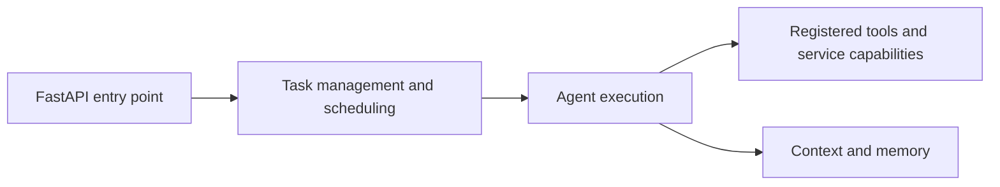

# Agent framework portfolio overview

The framework separates an agent execution path from the service capabilities and tools that execution can use. The current public README documents single-agent execution, tool injection, local RAG, scheduling, and discussion tests.

## Review entry points

- The project declares Python `>=3.11,<3.13` in `pyproject.toml`.
- The local application is launched through `backend.local_code_chat_app:create_app`.
- Capability registration uses an explicit list of trusted service-owned registration entries.
- The original README documents SQLite initialization, Redis, local setup, configuration export/import, and test commands.

## Contribution boundaries

Kaifeng Yan's portfolio describes contributions to context and memory approaches, task-flow design, and web / business / agent integration within a team. This should not be interpreted as sole authorship of the complete framework or all of its dependencies.

## Configuration and validation

Keep model-provider and paid-tool configuration private. The existing export/import helper handles private runtime configuration; configuration files and live credentials are not portfolio artifacts. Run the repository's documented tests and service checks in the intended Python environment before making runtime claims.

The documentation-only portfolio update does not change framework execution, model settings, service access, or scheduling behavior.
